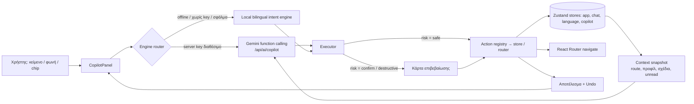

# Nakamas — AI-First Έλεγχος, Σύγκριση Projects & Πλάνο Εξέλιξης

**Ημερομηνία:** 13/11/2026 · **Αντικείμενο:** σύγκριση `Animus1991/parea_app` (τοπικό project, «local») με `Animus1991/nakamas_google_ai_studio_animus_91` (project του άλλου LLM, Google AI Studio / Gemini, «nakamas»), μεταφορά ό,τι υπερέχει, και πλάνο AI-first εξέλιξης με κεντρικό ανταγωνιστικό χαρακτηριστικό ένα AI που ελέγχει και συμπληρώνει τα πάντα μέσα στην πλατφόρμα.

**Συμπληρώνει:** `FULL_APP_UIUX_AUDIT_AND_PLAN.md` (Φ16–Φ22), `ACCEPTANCE_MATRIX.md`, `MERGE_INTEGRATION.md`.

**Ρήτρα μη αφαίρεσης:** καμία υπάρχουσα σελίδα, κουμπί, modal ή λειτουργία δεν αφαιρείται. Ό,τι μετακινείται (π.χ. progressive disclosure σε tabs/sheets) παραμένει προσβάσιμο με ένα κλικ.

---

## Α. Μεθοδολογία

1. Πλήρες `git log --stat` και των δύο repos· ανάγνωση κάθε αρχείου που άλλαξε στα 6 commits του nakamas.
2. Σύγκριση component-component (ίδια ονόματα αρχείων υπάρχουν και στα δύο, κοινή καταγωγή από το ίδιο AI Studio export).
3. Έλεγχος υγείας: `tsc --noEmit` (και τα δύο: 0 σφάλματα), `vitest` (local: 9/9), `eslint` (local: 0 errors / 128 warnings), `audit:contrast` (local: 54 ζεύγη, PASS).
4. Κάθε απόφαση μεταφοράς κρίνεται με 4 κριτήρια: (α) καθαρότητα με την πρώτη ματιά, (β) πραγματικά δεδομένα από το store αντί για hardcoded, (γ) a11y/i18n, (δ) αρχιτεκτονική συνέπεια με tokens/primitives του local.

---

## Β. Τι έκανε το άλλο LLM στο nakamas (χρονολόγιο)

| Commit | Ημ/νία | Ουσία | Κρίση |
|---|---|---|---|
| `aa3c14f` | 12/05 | Initial | — |
| `b99996e` | 14/05 | i18n scripts, 7×-themed σελίδες (όπως το παλιό local) | Ήδη απορροφημένο στο local |
| `fbedcd6` | 14/05 | «Standardize text colors to black» σε ~140 αρχεία | ❌ Οπισθοδρόμηση: `text-black` σπάει τα dark themes· το local λύνει το ίδιο με semantic tokens (`text-ink`) + contrast gate |
| `ca686ef` | 31/05 | Εξαγωγή `*PageContent` (ίδιο pattern με local Φ15–Φ21), ~40 repair scripts | Pattern ✅ (ήδη στο local)· scripts ❌ (θόρυβος στη ρίζα) |
| `266113c` | 01/06 | Βέλη πλοήγησης στο StoryViewer | Ήδη στο local (`SlideNavArrows`) |
| `fd86a59` | 13/11 | Gamification hub, tabbed Admin/Organizer, Profile ×2.5, EventCard drawer, Skeleton ×4, collapsible nav, 8 screenshots τρίτης εφαρμογής | **Η μόνη πραγματικά νέα δουλειά** — αναλύεται παρακάτω |

**Συμπέρασμα:** η κύρια συνεισφορά του άλλου LLM είναι **σχεδιαστική** (progressive disclosure, μινιμαλισμός καρτών, ιεραρχία πληροφορίας). Η local υπερέχει σε **ακεραιότητα δεδομένων, persistence, a11y, testing, ασφάλεια, αρχιτεκτονική**.

---

## Γ. Μήτρα σύγκρισης ανά περιοχή

Σύμβολα: 🟢 υπερέχει · 🟡 ισοδύναμο · 🔴 υστερεί · ➜ ενέργεια στο local.

| Περιοχή | nakamas | local | Ενέργεια |
|---|---|---|---|
| Routing | 🔴 eager imports, χωρίς ErrorBoundary ανά route, `/admin` εισάγεται ως `SettingsPage` | 🟢 lazy + ErrorBoundary + onboarding guard + `/calendar→/agenda` | Κρατάμε local |
| Theming | 🔴 `themes.ts` (παλιό snapshot), `text-black` sweep | 🟢 `designTokens.ts` + semantic CSS vars ανά `data-theme` + contrast CI | Κρατάμε local |
| Gamification IA | 🟢 Ενιαίο hub με segmented tabs· `/leaderboard` & `/challenges` ανοίγουν το ίδιο hub με `defaultTab` | 🟡 3 ξεχωριστές σελίδες χωρίς κοινή πλοήγηση | ➜ Κοινό `GamificationHubNav` στις 3 σελίδες + ring level gauge + summary strip |
| Gamification δεδομένα | 🔴 όλα hardcoded (XP, leaderboard, badges) | 🟡 XP live (`computeUserXp`), badges hardcoded | ➜ Badges/πρόοδος υπολογίζονται από πραγματικά δεδομένα store (`lib/achievements.ts`) |
| Daily challenge | 🟢 2 σαφή CTA («Μετάβαση» / «Ολοκλήρωση») | 🟡 όλη η κάρτα clickable, χωρίς όριο ανά ημέρα | ➜ 2 CTA + μία φορά ανά ημέρα (persisted) |
| Admin | 🟢 IA: Overview/Reports/Users/System tabs, χρήστες με suspend/restore, safeguards, chart 7d/30d, system status | 🟢 δεδομένα: live reports, admin log, Automation/Branding/SSO | ➜ Προσθήκη tabs Users + System (persisted στο store, `role="switch"`) + activity chart από πραγματικά events· τίποτα δεν αφαιρείται |
| Organizer | 🟢 Events/Analytics tabs | 🟢 live δεδομένα, 8 wired actions | ➜ Progressive disclosure tabs πάνω από υπάρχον περιεχόμενο |
| Profile | 🟢 3 tabs (Overview / Tiers & prefs / Privacy), clickable metrics, invite card | 🟢 persisted privacy (`userSettings`), live tiers | ➜ Tabs + `?tab=` URL sync + clickable live metrics + invite card |
| Trust Center | 🟢 Status/History tabs, «Πώς υπολογίζεται η αξιοπιστία» | 🟡 μία στήλη | ➜ Tabs + επεξηγηματικές κάρτες |
| EventCard | 🟢 μία «ήσυχη» γραμμή metadata, safety/χάρτης/ETA/άφιξη σε **ένα** sheet, status-aware κουμπί | 🔴 mini-map σε κάθε κάρτα, inline safety panel, διπλό Save (πάνω + κάτω) | ➜ Αποσυμφόρηση κάρτας: ίδια λειτουργικότητα μέσα σε `BottomSheet` |
| Skeletons | 🟢 `role="status"`, `aria-busy`, i18n label, list variants (5), stories skeleton | 🔴 3 βασικά, χωρίς a11y semantics | ➜ Superset (διατήρηση υπαρχόντων exports) |
| TabBar | 🟡 focus tokens | 🔴 χωρίς `role="tablist/tab"`, `aria-selected`, βέλη πληκτρολογίου | ➜ Πλήρες WAI-ARIA tabs pattern (roving tabindex) |
| Side nav | 🟢 collapsible sections με μετρητές, auto-open ενεργού | 🟡 8 πάντα-ανοικτές ενότητες (24 items) | ➜ Collapsible sections (persisted), ενεργή ενότητα πάντα ανοικτή |
| Gemini | 🔴 stub που επιστρέφει πάντα ερωτήσεις anime· `isGeminiConfigured()` πάντα `true` | 🟡 proxy + rate limit, μόνο blurbs/icebreakers | ➜ **Nakamas AI Copilot** (ενότητα ΣΤ) |
| Ασφάλεια κλειδιού | 🔴 key στο `.env` client | 🔴 `vite.config.ts` κάνει `define` το `GEMINI_API_KEY` **μέσα στο client bundle** | ➜ Αφαίρεση define· key μόνο server-side |
| Repo hygiene | 🔴 ~40 one-off scripts στη ρίζα, κενά αρχεία, `app/applet` αντίγραφο, 3.6MB screenshots τρίτης εφαρμογής | 🟢 scripts σε `scripts/`, docs, CI | Κρατάμε local |
| Tests / CI | 🔴 κανένα | 🟢 vitest, Playwright + axe matrix, contrast gate, CI | ➜ Νέα tests για AI engine |
| Calendar, Home, Chat, BuddySeek, Onboarding, Login | 🔴 μικρότερα, παλαιότερα | 🟢 υπερσύνολο | Κρατάμε local |

---

## Δ. Αρχιτεκτονική χωροθέτηση στο nakamas (ευρήματα για αναφορά)

1. `src/pages/Plans.tsx` = σελίδα **συνδρομών** (basic/pro/organizer) ενώ το nav το ονομάζει «Τα Σχέδιά μου» → σύγκρουση ονοματολογίας (το local έλυσε: `/plans` = δικά μου σχέδια).
2. `src/components/events/CreateEventFlowContent.tsx` ζει στο `events/` ενώ είναι flow δημιουργίας → local: `components/create/`.
3. `OrganizerDashboardPageContent` στο `admin/` (ίδιο και στο local) → ορθότερο `organizer/`· δεν μετακινείται στο local για να μη σπάσουν imports (σημειώνεται ως tech debt χαμηλής προτεραιότητας).
4. `AchievementsPageContent` κάνει render Leaderboard/Challenges ως tabs, αλλά τα δεδομένα ζουν μέσα στο component → πρέπει να ζουν σε `lib/` (local: `lib/gamification.ts`, νέο `lib/achievements.ts`).
5. Admin safeguards / suspensions / profile privacy σε `useState` → χάνονται σε refresh και δεν μοιράζονται· στο local ανήκουν στο persisted store.
6. `hooks/use-mobile.ts` και `hooks/use-mobile.tsx` διπλότυπα.
7. `services/gemini.ts` stub χωρίς proxy — κανένα AI στην πράξη.

---

## Ε. Ευρήματα ποιότητας/ασφάλειας στο local (διορθώνονται)

| # | Εύρημα | Ενέργεια |
|---|---|---|
| Ε1 | `vite.config.ts` → `define['process.env.GEMINI_API_KEY']` ενσωματώνει το server key στο JS bundle | Αφαίρεση· το AI περνά μόνο από `/api/ai/*` |
| Ε2 | Η γλώσσα (`LanguageProvider`) είναι `useState` → χάνεται σε κάθε refresh και δεν ελέγχεται εκτός React | Persisted `languageStore` (ίδιο API `useLanguage`) |
| Ε3 | `TabBar` χωρίς tab semantics | WAI-ARIA tabs |
| Ε4 | Skeletons χωρίς `role="status"` | a11y skeletons |

---

## ΣΤ. Nakamas AI Copilot — αρχιτεκτονική AI-first

### ΣΤ1. Στόχος προϊόντος

Ο χρήστης γράφει (ή λέει) σε φυσική γλώσσα, ελληνικά ή αγγλικά, και το AI **κάνει** — δεν απαντά μόνο:
«βρες μου δωρεάν πεζοπορία αυτό το σαββατοκύριακο», «αποθήκευσε το δεύτερο», «βάλε σκοτεινό θέμα», «άλλαξε γλώσσα σε αγγλικά», «γράψε στην ομάδα ότι θα αργήσω 10 λεπτά», «φτιάξε εκδήλωση για σινεμά την Παρασκευή στις 21:00», «πρόσθεσε φωτογραφία στα ενδιαφέροντά μου», «τι έχω αυτή την εβδομάδα;», «πώς ανεβαίνει η αξιοπιστία μου;».

### ΣΤ2. Επίπεδα

### ΣΤ3. Action registry (μία πηγή αλήθειας)

Κάθε ενέργεια δηλώνεται **μία φορά** (`src/ai/actions.ts`) με: όνομα, δίγλωσση περιγραφή, JSON schema παραμέτρων (χρησιμοποιείται αυτούσιο ως Gemini `functionDeclarations`), **risk tier** (`safe` / `confirm` / `destructive`), `run()` που καλεί υπάρχουσες store actions, και προαιρετικό `undo()`.

| Ομάδα | Ενέργειες |
|---|---|
| Πλοήγηση | `navigate` (όλες οι σελίδες με συνώνυμα EL/EN), `open_event` (fuzzy τίτλος/«το δεύτερο») |
| Ανακάλυψη | `search_events` (κείμενο, κατηγορία, ημερομηνία, τιμή, περιοχή, mood) → κάρτες στο chat + προαιρετική εφαρμογή φίλτρων στο Home μέσω URL, `recommend_events` (personalization score) |
| Σχέδια | `save_event`, `unsave_event`, `join_waitlist`, `start_join_flow`, `leave_group` (destructive), `add_to_calendar` (.ics / Google), `summarize_agenda` |
| Δημιουργία | `draft_event` (προσυμπλήρωση `/create` μέσω query), `create_event` (confirm) |
| Κοινότητα | `send_group_message`, `open_chat`, `accept_connection`, `decline_connection`, `find_company` (BuddySeek) |
| Προφίλ & ρυθμίσεις | `set_theme`, `set_language`, `update_bio`, `add_interest`, `remove_interest`, `update_privacy`, `update_notification_prefs`, `toggle_sidebar` |
| Ειδοποιήσεις | `mark_notifications_read`, `summarize_notifications` |
| Gamification | `show_progress`, `join_challenge` |
| Ασφάλεια & υποστήριξη | `report_issue` (confirm, προσυμπλήρωση), `explain` (βάση γνώσης: αξιοπιστία, βαθμίδες, ομάδες, ασφάλεια, BuddySeek) |
| Admin (μόνο organizer/admin) | `resolve_report` (confirm) |

### ΣΤ4. Ασφάλεια & εμπιστοσύνη (industry standards)

1. **Human-in-the-loop:** ό,τι δημοσιεύει, στέλνει σε τρίτους ή διαγράφει → κάρτα επιβεβαίωσης με ακριβή προεπισκόπηση.
2. **Undo** σε κάθε αναστρέψιμη ενέργεια (θέμα, γλώσσα, αποθήκευση, ενδιαφέροντα, privacy).
3. **Least privilege:** το model βλέπει μόνο ενέργειες που επιτρέπει ο ρόλος (admin actions κρυφές για απλούς χρήστες)· παράμετροι επικυρώνονται client-side πριν την εκτέλεση· άγνωστες ενέργειες απορρίπτονται.
4. **Ιδιωτικότητα:** το context snapshot περιέχει μόνο ό,τι χρειάζεται (όνομα, ενδιαφέροντα, πόλη, τίτλοι σχεδίων) — όχι email, τηλέφωνο, τοποθεσία.
5. **Διαφάνεια:** badge «Gemini» ή «Τοπικός βοηθός» — ποτέ δεν προσποιείται cloud AI όταν τρέχει τοπικά.
6. **Server-side key**, rate limit ανά IP, όριο μεγέθους ιστορικού, timeout.
7. **Graceful degradation:** κάθε αποτυχία Gemini → local engine, χωρίς σπασμένη εμπειρία.

### ΣΤ5. Local engine (λειτουργεί χωρίς κανένα κλειδί)

Ντετερμινιστικός δίγλωσσος parser: κανονικοποίηση τόνων/πεζών, συνώνυμα σελίδων/κατηγοριών/θεμάτων, εξαγωγή ημερομηνίας (σήμερα, αύριο, σαββατοκύριακο, εβδομάδα, μήνας, ονόματα ημερών), τιμής (δωρεάν/επί πληρωμή/έως Χ€), ώρας (21:00, 9μμ), περιοχής. Υποστηρίζει **συνεχή αναφορά** («αποθήκευσε το δεύτερο» → τελευταία αποτελέσματα αναζήτησης). Καλύπτεται από unit tests.

### ΣΤ6. Σημεία εισόδου (ανακαλυψιμότητα)

- Κουμπί «Nakamas AI» στο TopNav + `Ctrl/⌘ J`.
- Command palette (`Ctrl/⌘ K`): γραμμή «Ρώτα το AI: …» για κάθε ερώτηση που δεν είναι σελίδα.
- Page-aware chips: διαφορετικές προτάσεις ανά σελίδα (Home: «Σχέδιο για το Σαββατοκύριακο», Ημερολόγιο: «Τι έχω αυτή την εβδομάδα;», Δημιουργία: «Γράψε περιγραφή», Ρυθμίσεις: «Σκοτεινό θέμα», Βοήθεια: «Πώς λειτουργεί η αξιοπιστία;»).
- Inline prompt στο Home και στο Help Center.
- Φωνητική είσοδος (Web Speech API, `el-GR` / `en-US`) όταν υποστηρίζεται.

---

## Ζ. Συνοχή δεδομένων (ποιος γράφει / ποιος διαβάζει)

| Δεδομένο | Πηγή αλήθειας | Αναγνώστες | Γράφει το AI; |
|---|---|---|---|
| Γλώσσα | `languageStore` (νέο, persisted) | όλη η UI | ✅ `set_language` |
| Θέμα | `useStore.theme` | AppShell, tokens | ✅ `set_theme` |
| Αποθηκευμένα | `useStore.savedEvents` | Saved, EventCard, Stories, Detail | ✅ |
| Ομάδες/σχέδια | `useStore.groups` | Plans, Calendar, Chat, Organizer | ✅ (leave με confirm) |
| Μηνύματα | `chatStore.messages` | Popup chat, Inbox, GroupChat | ✅ `send_group_message` (confirm) |
| Privacy | `useStore.userSettings.privacy` | Settings, Profile | ✅ |
| Ειδοποιήσεις | `useStore.notifications` | Notifications, TopNav badge | ✅ |
| Αναφορές | `useStore.issueReports` | Admin | ✅ (confirm) |
| Admin safeguards / suspensions | `useStore.adminSafeguards`, `suspendedUserIds` (νέα, persisted) | Admin | ⛔ μόνο admin UI |
| Copilot ιστορικό | `copilotStore` (persisted, max 60 μηνύματα) | CopilotPanel | — |

---

## Η. Αρχές UI/UX συνοχής (εφαρμόζονται σε κάθε σελίδα που αγγίζεται)

1. **Progressive disclosure:** μία οθόνη = ένας σκοπός· δευτερεύοντα σε tabs/sheets, όχι σε ατελείωτο scroll.
2. **Ένα κύριο CTA ανά επιφάνεια** (primary token)· τα υπόλοιπα outline/ghost.
3. **Ήσυχη μεταπληροφορία:** μία γραμμή «ώρα · περιοχή · θέσεις» αντί για chips-σε-chips.
4. **Μόνο semantic tokens** (`text-ink`, `bg-surface-raised`, `border-border`, `bg-accent`) σε νέα components → αυτόματα σωστά σε 9 θέματα.
5. **WAI-ARIA πρότυπα:** tabs, switch, dialog, status· στόχοι αφής ≥ 40px.
6. **Δίγλωσσο παντού** μέσω `t()`, συμπεριλαμβανομένων aria-labels.
7. **Κάθε ψηφίο αληθινό:** μετρητές από store, όχι hardcoded.

---

## Θ. Roadmap

| Φάση | Περιεχόμενο | Κριτήριο αποδοχής |
|---|---|---|
| **Φ23 — AI core** | `src/ai/*` registry, local engine, Gemini engine, copilot store, `/api/ai/status`, `/api/ai/copilot`, persisted γλώσσα, αφαίρεση leaked key | Unit tests engine/registry· λειτουργία χωρίς key |
| **Φ24 — AI UI** | CopilotPanel, launcher, ⌘J, palette bridge, chips ανά σελίδα, φωνή, confirm/undo κάρτες | Axe-clean panel σε light/dark· keyboard-only χρήση |
| **Φ25 — Ports από nakamas** | TabBar a11y, Skeletons, Profile tabs, Gamification hub + live achievements, Admin Users/System, Trust tabs, collapsible nav, EventCard sheet, Organizer tabs | Καμία αφαίρεση· typecheck/lint/tests/contrast πράσινα |
| Φ26 — Proactive AI (επόμενο) | Ειδοποιήσεις «το AI προτείνει» (π.χ. ομάδα που γεμίζει, εκκρεμές feedback), σύνοψη εβδομάδας κάθε Δευτέρα, AI moderation hints στο Admin | — |
| Φ27 — Server-side tools (επόμενο) | Μεταφορά registry σε backend όταν υπάρξει πραγματικό API· audit log ενεργειών AI | — |

---

## Ι. Κατάσταση υλοποίησης (14/11/2026)

Σύμβολα: ✅ ολοκληρώθηκε & επαληθεύτηκε · 🟡 μερικό / εξαρτάται από εξωτερικό κλειδί · ⬜ επόμενη φάση.

### Ι1. Φ23 — AI core

| Στοιχείο | Κατάσταση | Αρχεία |
|---|---|---|
| Action registry (33 ενέργειες, risk tiers, preview, undo, least privilege) | ✅ | `src/ai/actions.ts`, `src/ai/types.ts` |
| Τοπικός δίγλωσσος engine (ημερομηνίες, ώρες, τιμές, κατηγορίες, περιοχές, ordinals, «αυτή η εκδήλωση», πολλαπλές ρυθμίσεις σε μία φράση) | ✅ | `src/ai/localEngine.ts`, `src/ai/entities.ts`, `src/ai/text.ts` |
| Αναζήτηση/κατάταξη με personalization + έντιμη χαλάρωση φίλτρων | ✅ | `src/ai/eventSearch.ts` |
| Βάση γνώσης (αξιοπιστία, βαθμίδες, ομάδες, ασφάλεια, Βρες Nakamas, XP, απόρρητο, πληρωμές, ακύρωση) με live δεδομένα χρήστη | ✅ | `src/ai/knowledge.ts` |
| Gemini function calling (proxy, έως 4 γύροι εργαλείων, echo thought signatures, fallback σε τοπικό) | 🟡 κώδικας ✅ · απαιτεί `GEMINI_API_KEY` στον server | `src/ai/geminiClient.ts`, `src/ai/copilot.ts`, `server.ts` |
| `/api/ai/status`, `/api/ai/copilot` (validation μεγέθους, rate limit, key μόνο server-side) | ✅ | `server.ts` |
| Ε1: αφαίρεση `GEMINI_API_KEY` από το client bundle | ✅ | `vite.config.ts` |
| Ε2: persisted γλώσσα + `<html lang>` | ✅ | `src/store/languageStore.ts`, `src/lib/i18n.tsx` |
| Copilot store (persisted συνομιλία ≤60, μνήμη αποτελεσμάτων, ασφαλής ακύρωση εκκρεμοτήτων σε reload) | ✅ | `src/store/copilotStore.ts` |

### Ι2. Φ24 — AI UI

| Στοιχείο | Κατάσταση |
|---|---|
| Docked panel ≥1024px (η σελίδα μένει διαδραστική), full-screen dialog σε κινητά, `Ctrl/⌘ J`, Esc | ✅ |
| Κάρτες αποτελεσμάτων (αρίθμηση για «το δεύτερο»), επιβεβαίωση/ακύρωση, αναίρεση, σύνδεσμοι | ✅ |
| Page-aware chips (20+ σελίδες), inline prompt σε Ανακάλυψη / Βοήθεια / Εμπιστοσύνη | ✅ |
| Command palette → «Ρώτα το Nakamas AI» για κάθε ερώτηση που δεν είναι σελίδα | ✅ |
| Φωνητική υπαγόρευση (Web Speech API, `el-GR` / `en-US`, progressive enhancement) | ✅ |
| Δημιουργία εκδήλωσης: AI prefill (`?ai=1&…`) + «Γράψε με AI» (Gemini ή τοπικό template) | ✅ |
| Floating chats μετακινούνται αριστερά του docked panel· TopNav αποσυμφορείται όταν είναι ανοιχτό | ✅ |

### Ι3. Φ25 — Ports από nakamas (προσαρμοσμένα σε live δεδομένα & tokens)

| Port | Κατάσταση | Τι βελτιώθηκε έναντι nakamas |
|---|---|---|
| `TabBar` WAI-ARIA tabs + `segmented` variant | ✅ | roving tabindex, ←/→/Home/End, `aria-controls` |
| Skeletons (stories, list variants, compact card) | ✅ | ίδιο a11y μοτίβο, χρήση στις Ειδοποιήσεις |
| Profile tabs (Overview / Tiers / Privacy) + invite card | ✅ | `?tab=` deep link, κουμπιά-metrics αντί για clickable divs |
| Gamification hub (nav + ring + summary + daily challenge) | ✅ | **όλα live**: badges από `lib/achievements.ts`, streak από πραγματική δραστηριότητα, rank ίδιος με Leaderboard, daily challenge επαληθεύσιμο & μία φορά/ημέρα |
| Admin: Overview / Users / System | ✅ | suspensions & safeguards persisted + admin log, maintenance banner για όλους, activity chart από πραγματικά events, live no-show rate |
| Organizer: Events / Analytics tabs | ✅ | live πληρότητα & ικανοποίηση (ήταν 72% · 92/6/2 σταθερά) |
| Trust Center: Status / History | ✅ | live ιστορικό (ήταν hardcoded), σωστά ονόματα βαθμίδων, πραγματικοί κανόνες ±3/+2/−8/−15 |
| Collapsible side-nav sections | ✅ | persisted, μετρητές, ενεργή ενότητα πάντα ανοιχτή, rail/tablet αμετάβλητα |
| EventCard declutter + «Χάρτης & Ασφάλεια» sheet | ✅ | καμία λειτουργία δεν αφαιρέθηκε (χάρτης, ημερολόγιο, άφιξη, ETA, επαφή, live location μέσα στο sheet) |

### Ι4. Ευρήματα που εντοπίστηκαν & διορθώθηκαν κατά την υλοποίηση

| # | Εύρημα (προϋπήρχε) | Διόρθωση |
|---|---|---|
| Ν7 | Οι κατηγορίες της φόρμας δημιουργίας («Hiking & Outdoors», «Theatre»…) δεν ταίριαζαν με τις κατηγορίες του feed → νέες εκδηλώσεις δεν εμφανίζονταν στα φίλτρα | Canonical κατηγορίες (`getHomeCategoryTranslations`) |
| Ν8 | «Επεξεργασία» (`/create?edit=`) & templates (`?template=`) του Organizer δεν διαβάζονταν | Edit mode με `updateEvent`, template prefill |
| Ν9 | Trust tiers «Newcomer → Verified → Trusted → Super Trusted» αντίθετα με `lib/trust.ts` | 3 σωστές βαθμίδες |
| Ν10 | Το a11y matrix σταματούσε στο 1ο test (flaky contrast από fade-in animations) και έκρυβε 49 tests | Scan με reduced motion + `MotionConfig reducedMotion="user"` (WCAG 2.3.3) |
| Ν11 | Αποκαλύφθηκαν: slider ακτίνας χωρίς label (Nearby), 4 selects χωρίς label (BuddySeek privacy), progressbars χωρίς όνομα, home filter selects χωρίς label, hover κείμενα <4.5:1 | Όλα διορθώθηκαν· matrix 50/50 |
| Ν12 | Accent ως κείμενο πάνω σε accent-soft αποτυγχάνει AA στα Vibrant | Κανόνας: accent-text μόνο σε surface-raised· νέα ζεύγη στο `audit:contrast` |

### Ι5. Επαλήθευση

| Έλεγχος | Αποτέλεσμα |
|---|---|
| `tsc --noEmit` | ✅ 0 σφάλματα |
| `vitest` | ✅ 47/47 (38 νέα: engine, actions, achievements) |
| `eslint` | ✅ 0 errors (warnings 128 → 125) |
| `audit:contrast` | ✅ PASS (+5 νέα ζεύγη) |
| `vite build` | ✅ |
| Playwright (smoke + a11y smoke + matrix 5 θέματα × 10 σελίδες + copilot 3 σενάρια + copilot axe σε 5 θέματα) | ✅ 63/63 |

### Ι5β. Ενιαία λογική μεγεθών με το nakamas (δεύτερο πέρασμα)

Μετά το port στο nakamas, τα δύο projects μετρήθηκαν ξανά σε 23 σελίδες.
Για κάθε ρόλο κρατήθηκε η μικρότερη και πιο εναρμονισμένη τιμή από τα δύο.

| Ρόλος | Πριν (parea / nakamas) | Τώρα (και στα δύο) |
|---|---|---|
| Button sm / md / lg | 40·11 / 40·13 / 44·14 px · 36·11 / 40·11 / 40·13 px | 36·11 / 40·11 / 40·13 px (από nakamas) |
| Μέγιστο ύψος κουμπιού | 55 px (αναδίπλωση «Βρες Nakamas») · 40 px | 40 px, ετικέτες σε μία γραμμή |
| Padding καρτών | 16 px κυρίως · 20 px κυρίως | 16 px (από parea) |
| Καρτέλες κατηγοριών | 13 px, επικάλυψη σε στενή στήλη · 11 px | 11 px, χωρίς επικάλυψη |
| Κουμπί AI στην κεφαλίδα | 40 px · 13 px | 40 px · 11 px |

Αυτόματος έλεγχος υπερχείλισης κειμένου σε κουμπιά (22 σελίδες, 1440/1024/390 px): 0 ευρήματα και στα δύο.

### Ι6. Επόμενα (Φ26–Φ27)

⬜ Proactive AI (ειδοποιήσεις «το AI προτείνει», εβδομαδιαία σύνοψη) · ⬜ server-side εκτέλεση εργαλείων όταν υπάρξει πραγματικό backend & audit log ενεργειών AI · ⬜ πραγματική επαλήθευση Gemini schema με ενεργό κλειδί (ο κώδικας ακολουθεί το επίσημο `functionDeclarations` format, αλλά δεν δοκιμάστηκε με έγκυρο κλειδί σε αυτό το περιβάλλον).
